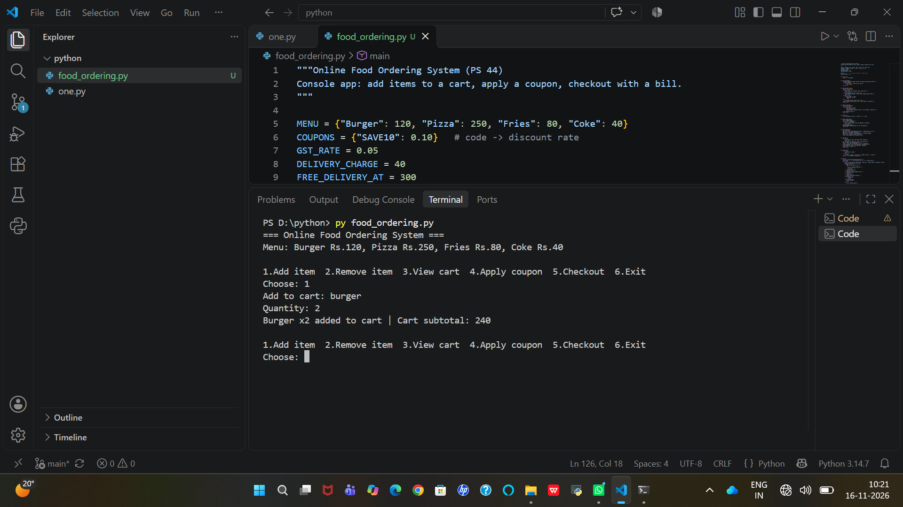
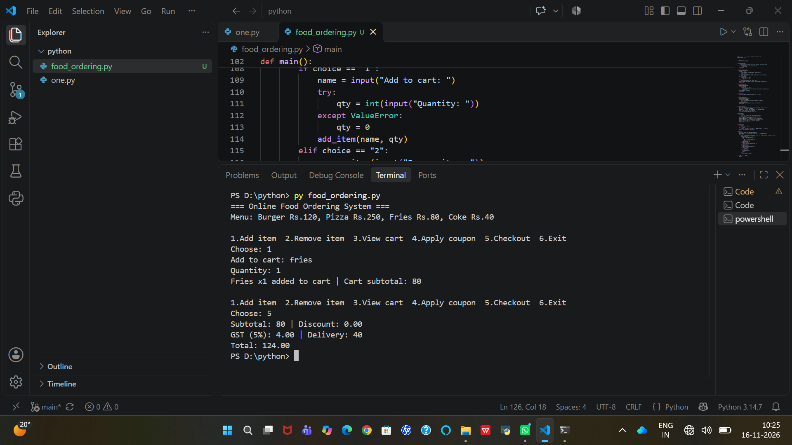
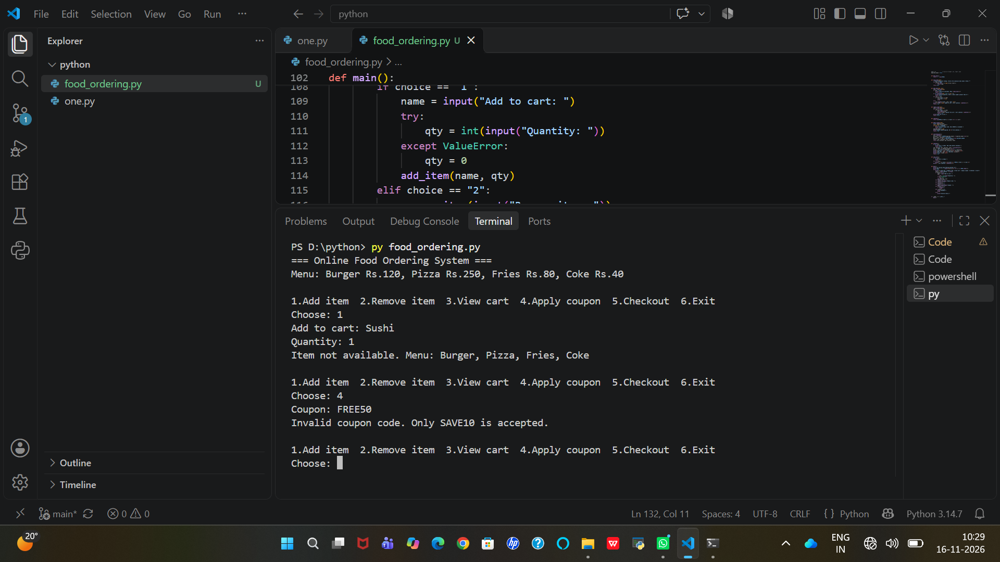
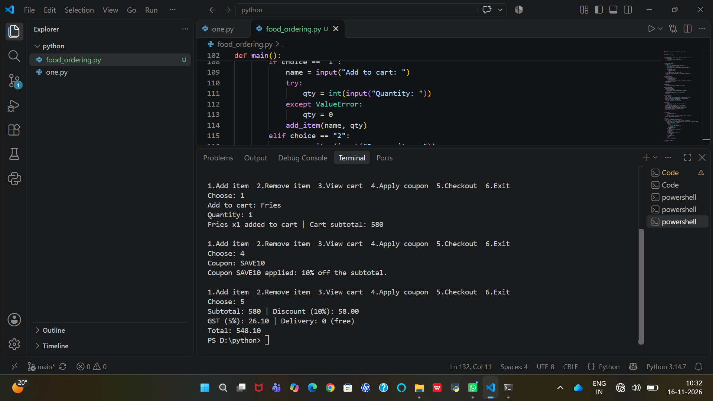

# Project Summary - Online Food Ordering System (PS 44)

## 1. Problem

Make a console food ordering system in Python where a customer adds items to a cart,
applies a coupon and gets a bill with discount, GST and delivery charge.

## 2. My approach

- Menu is a **dictionary** (item name -> price).
- Cart is a **list** where each entry holds the item name and quantity.
- Separate **functions** for adding an item, removing an item, applying a coupon,
  calculating the bill and checkout.
- A simple loop shows a menu of options (1 to 6) until the user checks out or exits.

## 3. Difficulties faced and how I solved them

1. **GST on which amount?** At first I was calculating GST on the full subtotal.
   The problem says GST is on the amount *after discount*, so I changed it to
   `(subtotal - discount) * 0.05`.
2. **Delivery charge rule.** Delivery is free only when the subtotal is 300 or more.
   I used the subtotal before discount for this check, which matches Test Case 4
   (subtotal 580 -> delivery free).
3. **Wrong quantity input.** If the user typed a word or 0 or a negative number as
   quantity, the program crashed. I used `try/except` and a check for quantity > 0.
4. **Same item added twice.** Instead of making two lines in the cart, I increase the
   quantity of the existing line.
5. **Upper/lower case.** Users may type `burger` or `save10`. I compare names and
   coupon codes after converting them to the same case.
6. **Decimal formatting.** Discount, GST and total had to show exactly 2 decimals
   (like `26.10`), so I used `:.2f` formatting.

## 4. Test cases and screenshots

### Test Case 1 - Normal input
Input: Add Burger, quantity 2
Expected: `Burger x2 added to cart | Cart subtotal: 240`

### Test Case 2 - Boundary / minimum input
Input: Add Fries x1, checkout (no coupon)
Expected:

    Subtotal: 80 | Discount: 0.00
    GST (5%): 4.00 | Delivery: 40
    Total: 124.00

### Test Case 3 - Invalid input
Input: (a) Add Sushi  (b) Coupon FREE50
Expected:

    Item not available. Menu: Burger, Pizza, Fries, Coke
    Invalid coupon code. Only SAVE10 is accepted.

### Test Case 4 - Different valid scenario
Input: Add Pizza x2, Fries x1, coupon SAVE10, checkout
Expected:

    Subtotal: 580 | Discount (10%): 58.00
    GST (5%): 26.10 | Delivery: 0 (free)
    Total: 548.10

## 5. Result

All 4 test cases give the expected output.

## 6. What I learned

How to use dictionaries and lists together, how to split a program into functions,
how to validate user input, and how a bill is calculated step by step.